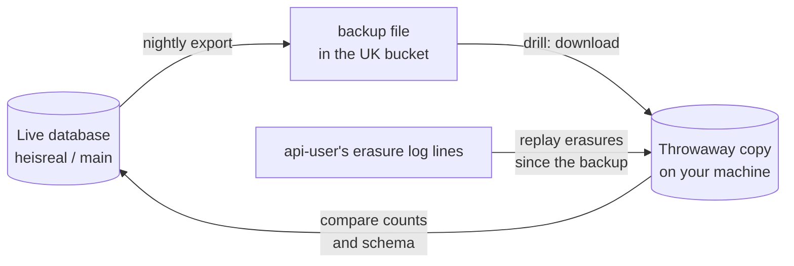

# Restore runbook: getting the database back from a backup

**Last drill: 2026-11-22, passed** (dev, nightly backup of 2026-11-22 02:30 UTC, restored into a
throwaway local copy; about 5 minutes end to end). Previous drill: 2026-10-05, passed.

Run the drill every few months and after big schema changes, and update the line above.

## What a backup is

Every night at 02:30 UTC a Kubernetes job exports the whole `heisreal/main` database (schema,
logins and rows) to one text file and uploads it to Cloud Storage:

```
gs://heisreal-<env>-db-backups/surrealdb/heisreal-main-<YYYYMMDDTHHMMSSZ>.surql
```

The job signs in as the read-only `backup` login and can only create files, never read or
overwrite older ones. Files are deleted after 30 days. They hold Article 9 data (people's
testimonies): download them only to your own machine, and delete them when you're done.



## The drill (dev)

Never import into the live database. The drill restores into a SurrealDB container on your own
machine that lives in memory and disappears when stopped.

You need: `gcloud` signed in, Docker, `kubectl` and access to the dev project. Before you start,
check no OpenTofu apply is running on dev (an apply may run a schema migration under you):

```bash
gh run list -R He-Is-Real/monorepo --workflow "OpenTofu apply" -L 3
```

### 1. Download the newest nightly backup

```bash
gcloud storage ls -l gs://heisreal-dev-db-backups/surrealdb/ | sort -k2 | tail -3
BACKUP=heisreal-main-20261122T023003Z.surql   # the newest one from the list
DRILL=$(mktemp -d /tmp/restore-drill.XXXX)            # 700: only you can read it
gcloud storage cp "gs://heisreal-dev-db-backups/surrealdb/$BACKUP" "$DRILL/restore.surql"
chmod 600 "$DRILL/restore.surql"
head -c 300 "$DRILL/restore.surql"                     # starts with "OPTION IMPORT;"
```

To take a fresh backup instead: see "Backups and restore" in `infra/k8s/surrealdb/README.md`
(`backup_run`). The nightly file is simpler and tests what we would really use.

### 2. Start a throwaway SurrealDB with the same version as live

Use the image pinned in `infra/k8s/surrealdb/base/kustomization.yaml` (today our patched build).

```bash
IMG=ghcr.io/he-is-real/surrealdb:v3.2.4-jwt11@sha256:72921e733c0598223df14b8329a2c842ec54e2adf828639954d959307c7e7ed7
docker run -d --rm --name restore-drill -p 127.0.0.1:18000:8000 -v "$DRILL:/drill:ro" \
  --user "$(id -u):$(id -g)" "$IMG" start --user root --pass drillpass memory
docker exec restore-drill /surreal version
```

`drillpass` is a local password for this container only. The container runs as you
(`--user`), so it can read the private backup file without opening it to other users.

### 3. Import the backup

```bash
docker exec restore-drill /surreal import --endpoint http://localhost:8000 \
  --username root --password drillpass --namespace heisreal --database main /drill/restore.surql
```

Expect `Import executed with no errors` (about one second for dev's ~230 KB file).

Two helpers for the checks below, one for the copy and one for live dev (live is read through the
read-only `backup` login, over a port-forward; it changes nothing):

```bash
copy() { docker exec -i restore-drill /surreal sql --endpoint http://localhost:8000 \
  --username root --password drillpass --namespace heisreal --database main --hide-welcome --json; }

# No gke-gcloud-auth-plugin here, so kubectl gets a token directly.
kubectl --token="$(gcloud auth application-default print-access-token)" \
  -n database port-forward svc/surrealdb 18001:8000 &
PF=$!
export BP="$(gcloud secrets versions access latest --secret=surreal-backup-password --project=heisreal-dev)"
live() { docker run --rm -i --network host "$IMG" sql --endpoint http://127.0.0.1:18001 \
  --auth-level database --username backup --password "$BP" \
  --namespace heisreal --database main --hide-welcome --json; }
```

### 4. Compare row counts with live

```bash
cat > "$DRILL/counts.surql" <<'EOF'
LET $t = object::keys((INFO FOR DB).tables);
RETURN object::from_entries($t.map(|$n| [$n, (SELECT VALUE count() FROM ONLY type::table($n) GROUP ALL LIMIT 1) ?? 0]));
EOF
copy < "$DRILL/counts.surql"
live < "$DRILL/counts.surql"
```

Every table should be there with the same or a plausible count. Live keeps changing after 02:30, so
for any table that differs, list the rows only one side has and check they were written after the
backup (look at their `at`, `addedAt` or `queuedAt` times):

```bash
echo 'SELECT VALUE id FROM storyFile;' | copy
echo 'SELECT VALUE id FROM storyFile;' | live
```

### 5. Compare the schema with live

The schema should match live exactly, except for migrations merged after the backup.

```bash
TABLES=$(echo 'RETURN object::keys((INFO FOR DB).tables);' | copy | grep -v '^$' \
  | python3 -c 'import json,sys; print(" ".join(json.load(sys.stdin)[0]))')
Q="INFO FOR DB;"; for t in $TABLES; do Q+=" INFO FOR TABLE \`$t\`;"; done
echo "$Q" | copy | grep -v '^$' > "$DRILL/copy-schema.json"
echo "$Q" | live | grep -v '^$' > "$DRILL/live-schema.json"
diff <(python3 -m json.tool --sort-keys "$DRILL/copy-schema.json") \
     <(python3 -m json.tool --sort-keys "$DRILL/live-schema.json")
```

Known difference: the restore drops the comments on the database logins (`backup`, `migrator`,
`dev_seed`). Harmless; the next SurrealDB init puts them back.

### 6. Spot reads

```bash
copy <<'EOF'
LET $s = (SELECT VALUE story FROM storyFile WHERE format = 'video' LIMIT 1)[0];
SELECT id, title, fn::story::status_of($this) AS status, submitter,
  (SELECT id, format, sizeBytes, storyVersion FROM storyFile WHERE story = $parent.id) AS files
  FROM ONLY $s;
SELECT id, status, termsOfUse, termsOfUseAgreedAt, testimonyConsent, testimonyConsentAgreedAt
  FROM user WHERE testimonyConsent != NONE LIMIT 2;
SELECT VALUE fn::story::status_of($this) FROM story;
SELECT id, publishedAt FROM termsOfUseAgreement, testimonyConsent, socialMediaSharingConsent, privacyNotice;
EOF
```

Expect: the story with its file rows, people with consent pointers and dates, stories in their
states, the legal texts.

### 7. Replay erasures since the backup

A backup still holds people who deleted their account after it was taken. api-user logs every
erasure with internal ids only (`Erased user:<id> (<reason>); N deletion(s) queued`, as JSON, so
the text is in `jsonPayload.message`). Find those since the backup's time:

```bash
gcloud logging read 'resource.labels.service_name="api-user" AND jsonPayload.message:"Erased user:"
  AND timestamp>="2026-11-22T02:30:00Z"' --project heisreal-dev \
  --format='value(timestamp,jsonPayload.message)'
```

For each one, erase the person again in the restored database. Only api-user's login may erase
(root is refused on purpose), so sign in as api-user:

```bash
AP="$(gcloud secrets versions access latest --secret=surreal-api-user-password --project=heisreal-dev)"
TOKEN=$(curl -sS -X POST http://127.0.0.1:18000/signin -H 'Accept: application/json' \
  -d "{\"ns\":\"heisreal\",\"db\":\"main\",\"ac\":\"svc\",\"name\":\"api_user\",\"secret\":\"$AP\"}" \
  | python3 -c 'import json,sys; print(json.load(sys.stdin)["token"])')
unset AP

USER_ID=user:xxxxxxxx   # from the log line
REASON=account_deleted  # the reason in brackets in the same log line
CLERK=$(echo "SELECT VALUE clerkUserId FROM ONLY $USER_ID;" | copy | grep -v '^$' \
  | python3 -c 'import json,sys; print(json.load(sys.stdin)[0])')
curl -sS -X POST http://127.0.0.1:18000/sql -H 'Accept: application/json' \
  -H "Authorization: Bearer $TOKEN" -H 'surreal-ns: heisreal' -H 'surreal-db: main' \
  --data-binary "BEGIN TRANSACTION; fn::account::erase('$CLERK', '$REASON'); COMMIT TRANSACTION;"
```

Use the reason from the log line. The first erasure logs before it works through its deletion
queue, so with `account_deleted` the Clerk account deletion may never have finished; replaying with
the same reason queues it again, and Clerk treats an account that's already gone as done. The
person's video files are queued for deletion again; Bunny treats a missing video as done. Afterwards the user row is `status = 'deleted'` with no Clerk id or
agreements, and there is one more `erasedIdentity` row.

On a drill with no erasures since the backup, try it on any test person in the copy to check the
step still works.

### 8. Clean up

```bash
docker stop restore-drill          # the copy lived in memory; it's gone
kill $PF                           # end the port-forward
rm -rf "$DRILL"
unset BP TOKEN CLERK REASON
```

Then update "Last drill" at the top of this file.

## A real restore

Not drilled end to end yet; the drill covers each step except importing into a live instance.

1. Stop writes to the database (through OpenTofu, like every cloud change).
2. Pick the newest backup from before the problem.
3. Import it into a new, empty database on the instance (or a new instance), as above but against
   the real endpoint, then point the services at it (OpenTofu). Never import over a database that has data.
4. Replay every erasure logged since the backup's time (step 7). This is required: people who
   deleted their account must stay deleted.
5. Run the schema migration so the schema matches main. A plain cluster apply shows no diff
   (the migrations haven't changed), so force the Job to run again:
   `tools/scripts/tf.sh cluster plan -replace='module.cluster.kustomization_resource.migrate' -out=cluster.plan`,
   read the plan, `tools/scripts/tf.sh cluster apply cluster.plan`, then check the new Job
   completes ("Order: migrate, then deploy" in `infra/k8s/surrealdb/README.md`).
6. Bring the services back and check the site.

## Results of the last drill (2026-11-22)

- Backup: `heisreal-main-20261122T023003Z.surql`, 229 KB, imported with no errors in about 1 s.
- All 31 tables present. Counts: 11 people (10 with terms of use and testimony consent pointers),
  26 stories (approved, pending, editing, rejected), 21 file rows, 46 status log rows, 19 themes in
  4 categories, one version each of the terms of use, testimony consent, social media consent and
  privacy notice, 0 blocked emails or IPs, 0 erasure tombstones. Live matched except rows written
  after 02:30 (2 file rows from a test upload at 15:44, 2 blocked emails added at 16:31, media jobs
  and status logs rewritten by the day's tests and apply).
- Schema: 62 functions, 49 events, 22 indexes, 172 fields, permissions on all 31 tables, both
  access methods (Clerk and service logins). Identical to live except a function and an event
  changed by a migration merged at 16:40 (pictures have no smallest size), and the login comments
  above.
- Spot reads: a video story with its file row; people's consent pointers with dates.
- Erasure replay: no erasures since the backup; replay tried on one test person in the copy and
  worked (stub, no Clerk id or agreements, tombstone written).
